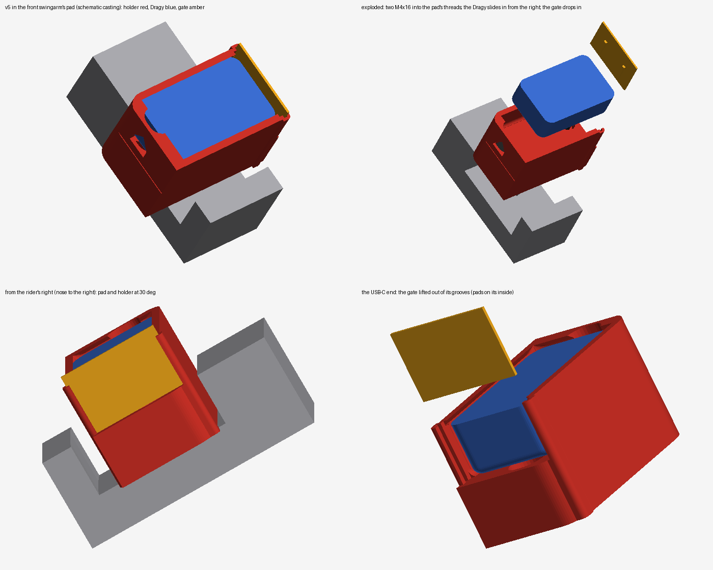

# Dragy mount for the Radium Mach One S

A 3D-printable holder for a **Dragy GPS laptimer** on a Radium Mach One S electric skateboard,
closed at its USB-C end by a sprung **gate** that stops the Dragy rattling and covers the charging port.

The holder sits in the recessed pad on top of the **front swingarm**, beyond the deck's nose, where
the sky is open, and screws into the pad's two M4 threaded holes, which Radium put there for
accessories like this.

**Status:** v5, not yet printed. The v4 holder (2026-11-16) prints cleanly and fits the pad snugly; v4's TPU cap came
off too easily, so v5 replaces it with a PLA gate; see the roadmap. v1 bolted a tray onto the **shoe** (`shoe.py`), the anchor that
locks into the oval hole and that holds the rear lights in
[beadon/shredlight-mounts](https://github.com/beadon/shredlight-mounts). The front pad's threaded
holes make that unnecessary here, but the shoe stays in this repo as its own component for other uses.



## Parts

| Part | File (in `out/`) | Print |
|---|---|---|
| Holder | `dragy_holder_v5.stl` | Floor down. No supports: nothing overhangs (45° lip undersides, a pointed top on the far-end push-out hole, vertical grooves). |
| Gate | `dragy_gate_v5.stl` | Flat, outer face down, pads up. No supports. **PLA** (PETG if it relaxes in the heat): it's the spring. |
| Assembly | `dragy_assembly_v5.obj` (+ `.mtl`) | For Blender: the parts in a schematic front swingarm pad. Not for printing. |
| Shoe (separate component) | `shoe.stl` | Not used by v2-v5. Top face down, plug up, no supports. See `shoe.py`. |

See [PRINT_SETTINGS.md](PRINT_SETTINGS.md) for the slicer profile.

## How it goes together

- **The pad** (measured): a flat area 66.3 mm across and 40.4 mm along the board (35 mm measured
  level), at the bottom of a pocket whose rim stands 15.55 mm above it. It's tipped 30° from flat,
  rising toward the nose. The oval hole is in its middle, with an M4 threaded hole either side,
  39.5 mm apart, across the board. The threads are about 4 mm long, right through the casting.
- **The holder** sits in the pocket, on the pad, held by two **M4×16** socket-head screws. They seat
  12 mm up in its floor, so their last 4 mm catch all of the pad's thread and stop flush with the
  casting's underside. The screws and the pocket's walls locate it. (An optional plug into the oval
  hole is `PLUG` in `dragy_mount.py`; it's off, because it would stop the holder printing floor-down.)
- **The Dragy** (42.98 × 26.96 × 13.94 mm, measured) lies parallel to the pad, logo up, long side
  across the board, so the GPS sees open sky. It slides in from the USB-C end, the rider's right.
  Lips along both long sides and the far end stop it lifting out, and two small bumps inside the side
  walls hold it while it charges. The far end's wall has an 8 mm push-out hole (pointed top, so it
  prints without supports): push through it to slide the Dragy out. It's 2 mm toward the nose of centre,
  so the wall covers the white connector (off centre toward the tail) and pushing can't damage it. The pocket's floor corners are
  rounded to match the Dragy's rounded bottom edges (2 mm; its top edges are sharp). The
  screw heads sit under the Dragy: slide it out to reach them.
- **The floor is thick on purpose:** it lifts the Dragy so its top is 14.8 mm above the rim and the
  USB-C port's centre 7.8 mm above it, so a charging cable plugs straight in from the right, over the rim.
- **The gate** closes the USB-C end. Past the open end, the side walls run on 2.5 mm as posts, each
  with a vertical groove; the gate, a 0.86 mm (2-line) PLA plate, drops into them from above and stands
  on the base's shelf. **The plate is the spring:** two pads on its inside press on the Dragy's end face
  either side of the USB-C opening (nothing touches the port), so the plate bows between its grooves and
  holds the Dragy against the far wall: no rattle along its length. The pads reach 0.4 mm into the Dragy
  with it against the far wall, 0.9 mm with it pushed out (estimate: 3.4-7.6 N per pad, 0.3-0.6 % strain,
  well within PLA's range). Their undersides are 45°, so as the gate goes down they ride over the Dragy's
  top edge and push it back. Pinch the tab above the holder's top and lift the gate out to charge
  (it needs ~20 mm of room above the holder). The spring force holds it in its grooves.
- **The pocket's sides run straight out of the open end** (v5): in v2-v4 its rounded plan corners narrowed
  the way out by ~1 mm each side, so the Dragy only got in by bending the walls.
- **The USB-C port is off centre** (measured): its case cut-out is 6.91 mm from one side wall and 10.21 mm
  from the other, so its centre is 1.65 mm off the Dragy's centreline. With the logo up and the USB-C end
  on the rider's right, it's toward the **tail** (`USB_SIDE` in `dragy_mount.py`).

Hardware: two M4×16 socket-head screws. A drop of removable threadlocker keeps them from backing out.

## Building

```sh
python3 -m venv .venv
.venv/bin/pip install -r requirements.txt
.venv/bin/python dragy_mount.py out   # holder and gate STLs and the assembly OBJ (runs every fit check)
.venv/bin/python shoe.py out          # the shoe on its own
.venv/bin/python render.py            # docs/render.png
```

Every dimension is a named constant, in millimetres, at the top of `shoe.py` and `dragy_mount.py`.
The scripts stop with an error if a check fails (parts overlapping, the Dragy not fitting, the
shoe not dropping into the hole or not locking, a pinched mesh).

## Not yet known

- The USB-C port's height on the Dragy's end face (assumed mid-height); the Dragy's plan-view corner radius (assumed 4 mm); and the white connector's exact position (the push-out hole was moved 2 mm toward the nose after the first test print, to keep it off the connector).
- Where the M4 holes sit along the pad (fitted to the test prints: 6.2 mm nose-ward of the pocket's centre) and the pocket's corner radii (nose end nearly a semicircle, ~20 mm; tail 8 mm assumed) and the size of a charging plug's moulding (assumed
  13 × 7.5 mm, 30 mm long) for the rim-clearance check.

## Roadmap

- [x] v1: a tray bolted onto the shoe (`shoe.py`, from shredlight-mounts r4), and the USB-C cap. Not printed.
- [x] Measure the front swingarm's pad: 30° (nose up), 66.3 × 40.4 mm, rim 15.55 mm, M4 holes 39.5 mm apart, 4 mm threads
- [x] v2: a holder in the front swingarm's pad, screwed into its two M4 holes, and the USB-C cap
- [x] Print v2's holder (2026-11-16): prints without supports (after rooting the tether hook in the wall); the Dragy fits but
  rattles left/right with the cap off; the centred push-out hole uncovered part of the white connector
- [x] v3: the push-out hole 2 mm toward the nose, so the wall covers the white connector
- [x] v2 in the pad (2026-11-16): its nose-side corners hit the pocket's rounded corners (the model's pad doesn't show this)
- [x] v3: the holder's body 1 mm toward the tail of the screws (`TRAY_Y`), its nose-side corners rounded 8 mm (`NOSE_R`)
- [x] Print v3 (2026-11-16): fits the pocket, but its holes rest about half a screw width (~2 mm) tail-ward of the pad's
  (the pocket's nose end is nearly a semicircle and the holes sit nose-ward of its centre); the nose-side snap bump
  for the cap was missing (cut off by v3's corner rounding)
- [x] v4: the screw holes 2.6 mm further toward the nose (`TRAY_Y` -3.6) and slotted ±1 mm along the board (`SLOT`);
  side walls 2.4 → 1.3 mm, 3 lines (the holder is 30.1 mm along the board, was 32.3; ~1 mm off the pocket's nose
  end), nose-side corners R6; the snap bump
  restored (and a check for both); the pad model refitted (nose end R20, holes 6.2 mm nose-ward)
- [ ] Measure where the M4 holes sit along the pad (centre to the nose-side and tail-side walls)
- [x] Print v4's holder (2026-11-16): prints cleanly and fits the pad snugly
- [x] Print v4's TPU cap (2026-11-17): it came off too easily (its snap bumps engaged ~0.3 mm), and the tether's ring
  was hard to get onto the hook (at 45° the ring's top edge met the wall before it reached the straight arm)
- [x] v5: the cap and tether replaced by a PLA gate in grooves past the open end; the plate is a bow spring whose two
  pads hold the Dragy against the far wall. The pocket's sides run straight out of the open end (its rounded
  corners narrowed the way out ~1 mm each side). The gate prints flat, the holder floor down, no supports
- [ ] Print v5: does the gate stop the rattle, slide in and out easily, and stay put on the road? Does a charging cable
  reach over the rim with the gate out?

## License

[GPL-3.0](LICENSE), the same as [shredlight-mounts](https://github.com/beadon/shredlight-mounts).
Dragy is a trademark of its owner, and Radium and Mach One of theirs. This project is not affiliated
with or endorsed by them.
